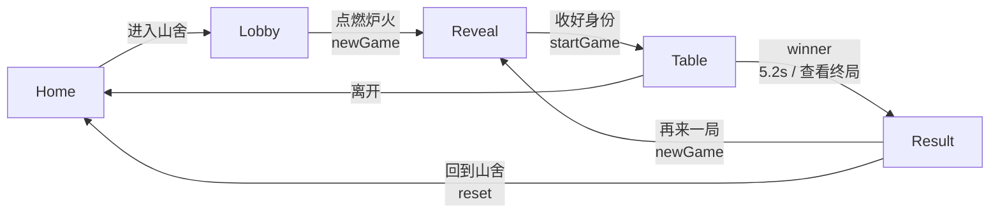
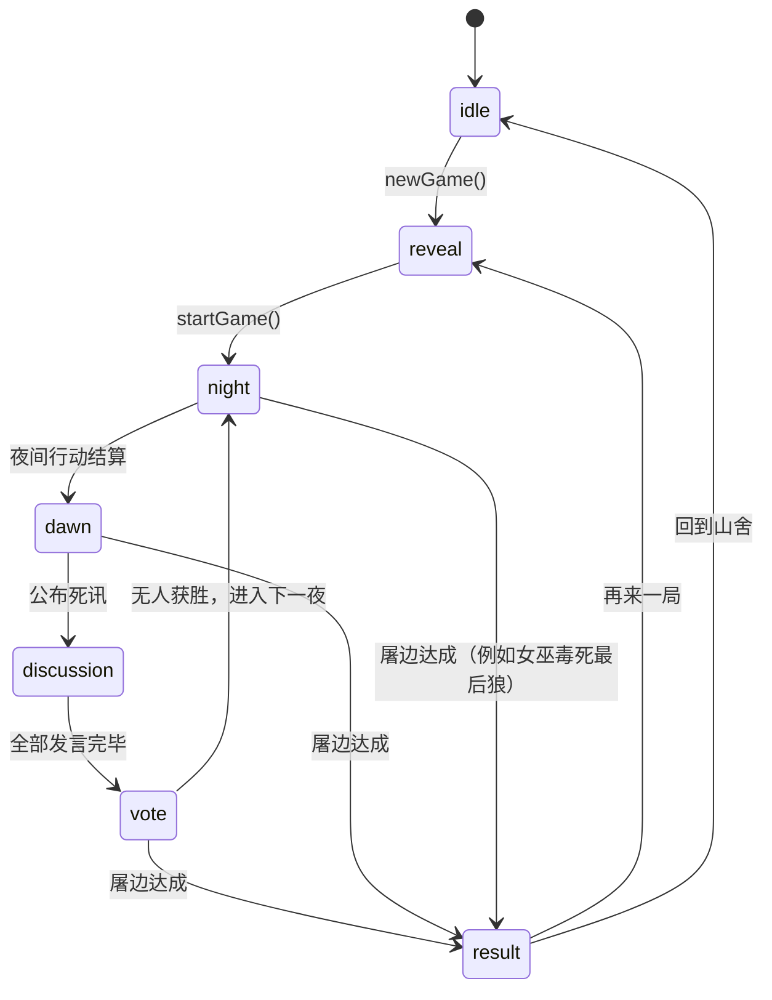

# 暮林夜话 · MULIN NIGHTFALL

> 九人局狼人杀 · Vue 3 + TypeScript + Three.js 的单机 3D 牌桌
>
> 可选智能体代理：8 位 AI 旅人可接入 OpenAI 兼容模型 / 灵矽人设
>
> 设计文档与可运行原型说明

---

## 1. 项目定位

「暮林夜话」是一款发生在暮色森林山舍里的九人狼人杀。玩家坐在 1 号位，与 8 位 AI 旅人围桌而坐；没有联机，所有身份、发言、投票和夜间行动都由本地游戏引擎完成。

默认可完全在浏览器内运行。若配置了智能体代理，8 位 AI 的公开发言会由模型生成；否则自动回退到规则模板。

核心目标：

- **九人局**：3 狼人 / 3 村民 / 1 女巫 / 1 守卫 / 1 预言家。
- **3D 牌桌**：纯程序化 Three.js 场景，不依赖外部模型或贴图。
- **参考视觉**：延续 `forest-cabin.html` 的暮林山舍气质——深墨绿、暖金、玻璃、衬线标题、克制的英文小字。
- **首屏直入**：打开即见「暮林夜话」主界面，不再有横条加载幕布；3D 镜头缓慢落位，旅人沿石径走向木屋。
- **完整可玩**：身份揭示、夜间技能、发言、投票、遗言、屠边判定、终局复盘，一条龙可玩到结束。

> 说明：参考 HTML 中的 Three.js 场景代码在原文件中不完整。当前场景按参考页的美术方向重新程序化搭建：暮色森林、暖光山舍、石径与旅人，首屏直接进入主界面。

---

## 2. 快速开始

```bash
cd mulin-night
npm install
npm run dev
# http://127.0.0.1:5188
```

其他命令：

```bash
npm run typecheck   # vue-tsc --noEmit
npm run build       # 类型检查 + 生产构建
npm run preview     # 预览 dist
```

技术栈：

| 层 | 选型 |
| --- | --- |
| 框架 | Vue 3.5 `<script setup>` |
| 语言 | TypeScript 5.9（strict） |
| 构建 | Vite 7 |
| 状态 | Pinia 3 |
| 路由 | Vue Router 4 |
| 3D | Three.js 0.180（`three/addons`） |
| 样式 | 原生 CSS + 设计 token |
| 音频 | WebAudio 程序化环境声（默认关闭） |
| 智能体 | Node 代理 + OpenAI 兼容接口（可选，Key 仅服务端） |

---

## 3. 体验主线

```
暮林山舍（首页 / 启动动画）
        │  进入山舍
        ▼
山舍大厅（九人名单 / 规则 / 开始）
        │  点燃炉火
        ▼
身份揭示（3D 翻牌 / 仅你可见）
        │  收好身份 · 入座
        ▼
牌桌（夜 / 昼 / 发言 / 投票）
        │  屠边达成
        ▼
终局（阵营 / 九人身份 / 数据 / 复盘）
```

四个场景之间使用「幕布」转场：同一场景家族内是镜头缓动，跨家族（木屋 ↔ 牌桌）是 360ms 遮罩 + 220ms 揭开。

### 3.1 页面与路由

| 路由 | 页面 | 3D 世界 | 进入条件 |
| --- | --- | --- | --- |
| `/` | 首页 | `home`：木屋、松林、月亮、火塘 | 任意 |
| `/lobby` | 大厅 | `lobby`：木屋另一机位 | 任意 |
| `/reveal` | 身份揭示 | `reveal`：牌桌家族，俯视桌面 | 已有牌局（`phase !== idle`） |
| `/table` | 牌桌 | `table`：九人圆桌 + 木屋背景 | 已揭示身份，且未终局 |
| `/result` | 终局 | `result`：拉远的牌桌 | 已有 `winner` |

路由守卫保证：

- `idle` 访问 `/reveal`、`/table`、`/result` → `/lobby`
- `/reveal` 在牌局已开始时 → `/table` 或 `/result`
- `/table` 在尚未揭示身份时 → `/reveal`；已终局 → `/result`
- `/result` 没有赢家 → 回到 `/table` 或 `/reveal`

### 3.2 转场层

`App.vue` 维护：

- 固定全屏 `WorldCanvas`（3D 场景）
- 路由 `RouterView` 的淡入淡出
- 场景家族切换时的 `.veil` 遮罩



---

## 4. 游戏流程与状态机

### 4.1 顶层状态

```ts
type Phase = 'idle' | 'reveal' | 'night' | 'dawn' | 'discussion' | 'vote' | 'result';
```



### 4.2 一夜的顺序

```
守卫 → 狼人 → 女巫 → 预言家 → 结算 → 天亮
```

- **守卫**：选择一人守护，可守自己；不能连续两晚守同一人。
- **狼人**：狼队共同选择一名非狼目标；人类狼人拥有决定权。
- **女巫**：知道今晚谁被袭击；解药与毒药**一晚只能使用一种**；解药、毒药各只有一瓶。
- **预言家**：查验一人阵营，结果仅自己可见。
- **结算**：
  - 被狼刀且未被守卫/女巫救 → 死亡。
  - 被守卫守护、同时被女巫解药救 → **同守同救，仍然死亡**。
  - 被毒药命中 → 死亡（守卫无效）。
- **天亮**：公布死讯；若触发屠边，直接终局。

### 4.3 白天

1. **发言**：按座位顺序依次发言；人类玩家轮到时有 45 秒计时。
2. **投票**：所有存活者投票；可弃票；人类 60 秒计时。
3. **放逐**：最高票者出局；平票则无人出局。
4. **遗言**：夜间死亡者、被放逐者可以留下遗言。
5. **胜负检查**：每次死亡后检查屠边。

### 4.4 胜负条件

| 阵营 | 胜利条件 |
| --- | --- |
| 好人 | 所有狼人出局 |
| 狼人 | **屠边**：所有村民出局，或所有神职出局 |

神职指：预言家、女巫、守卫。

---

## 5. 人机与单机结构

### 5.1 座位

- 1 号位 = 人类玩家，固定角色「沈砚」。
- 2–9 号位 = 8 位 AI 旅人，固定角色：
  白棠、陆离、苏九、顾青、江眠、温辞、阿箬、裴照。
- **角色牌每局随机洗牌**；人物与座位固定，保证 3D 人偶与座位芯片始终对应。

### 5.2 AI 行为

AI 由 `GameController` 驱动，不依赖服务端：

- `botGuardTarget`：优先守自己或高威胁目标，避免连守。
- `botWolfTarget`：避开狼队，优先袭击神职/活跃好人。
- `botWitchDecision`：按局势决定救、毒或收药。
- `botSeerTarget`：优先查验未查过、发言可疑的人。
- `botSpeech`：根据身份、轮次、已知信息生成中文发言；会踩人、保人、悍跳、倒钩。
- `botVote`：结合怀疑度、狼队协同、场上票型投票。
- `botLastWords`：遗言模板。

所有 AI 发言写入公共日志；预言家查验、女巫用药、狼队刀口写入「仅你可见」私密日志。

### 5.3 人类交互契约

`GameController` 通过 `store.ask(prompt)` 返回 `Promise<HumanAction>`，UI 只负责收集动作：

```ts
type HumanAction =
  | { target: number | null }
  | { save: true }
  | { poison: number }
  | { pass: true }
  | { abstain: true }
  | { text: string }
  | { auto: true }
  | { aborted: true };
```

Prompt 类型：

| kind | 场景 | UI |
| --- | --- | --- |
| `guard` | 守卫行动 | 9 人目标格 + 空守 |
| `wolf` | 狼人行动 | 9 人目标格，狼队禁用 + 放弃 |
| `seer` | 预言家查验 | 9 人目标格，自己禁用 |
| `witch` | 女巫用药 | 解药 / 毒药 / 收药 / AI；毒药进入二级目标选择 |
| `speech` | 白天发言 | 文本域 + 快捷句 + 45s |
| `vote` | 放逐投票 | 9 人目标格 + 弃票 |
| `lastWords` | 遗言 | 文本域 + 不留了 |

「交给 AI」会把当前动作以 `{ auto: true }` 交回控制器，由机器人策略代打；顶部「托管」则持续跳过所有人类 Prompt。

---

## 6. 3D 场景设计

### 6.1 两个场景家族

| 家族 | 路由 | 内容 |
| --- | --- | --- |
| 木屋 `cabin` | home / lobby | 暮色松林、石径、木屋、烟囱、暖窗、门灯、火塘、月亮、萤火、薄雾、走向门口的旅人 |
| 牌桌 `table` | reveal / table / result | 石座圆桌、九把座椅、符文转盘、蜡烛、卡牌、8 个人偶、观者座椅；木屋退到背景 |

场景全部程序化生成：

- `textures.ts`：木纹、瓦片、石纹、地面、光晕、月亮、烟、符文盘、火焰。
- `environment.ts`：天空 shader、月亮/月晕、星空、云、松林（InstancedMesh）、萤火、雾、火塘、散石。
- `cabin.ts`：原木墙体、屋顶、烟囱、门廊、窗、灯笼、烟、室内暖光。
- `cabinDetail.ts`：石砌墙脚、原木端头/填缝、分层瓦片、山墙木构、百叶窗、花箱、门牌、铁艺、门廊地板/栏杆/长凳、柴堆、路径灯与苔藓。
- `walkers.ts`：四位披斗篷的旅人，提灯沿石径缓慢走向木屋，带步态、驻足与灯火呼吸。
- `table.ts`：石座、桌面、餐具、蜡烛、符文盘、卡牌、9 把椅子、8 个人偶。
- `ForestWorld.ts`：渲染器、Bloom、相机、昼夜混合、座位投影、死亡/发言动画。

### 6.2 首屏与镜头

首屏不再有加载幕布，打开即见「暮林夜话」主界面；3D 从林缘高处缓慢推近：

```
(1.2, 6.8, 36) → 首页机位 (1.0, 4.3, 27.5)
目标 (-2.4, 3.4, -8) → (-3.2, 2.55, -8)
FOV 39 → 36
```

- 使用 `performance.now()` 的**墙钟时间**，避免低帧率设备上「慢动作」。
- 时长 4.8s，`easeInOutCubic`；主界面文字从一开始就可读、可点击，木屋从首帧起就在画面里。
- 旅人从画面前景沿石径走向木屋，和镜头落位同时发生；约 25–35s 到达门廊。
- 首页增加克制的暖光/暗角/胶片颗粒叠加，但不遮挡 UI。

### 6.3 相机预设

| 模式 | 位置 | 目标 | FOV |
| --- | --- | --- | --- |
| home | (1.0, 4.3, 27.5) | (-3.2, 2.55, -8) | 36 |
| lobby | (1.6, 4.0, 27) | (-4.8, 3.1, -8) | 38 |
| reveal | (0, 7.1, 11.2) | (0, 1.45, 0) | 40 |
| table | (0, 10.4, 18.4) | (0, 0.7, 0) | 42 |
| result | (0, 9.3, 18.2) | (0, 0.7, 0) | 42 |
| home / lobby（≤780px） | (0.8, 4.4, 36) / (1.6, 4.2, 33) | 同桌面 | 50 |
| table / result（≤780px） | (0, 12.6, 25.8) | (0, 0.7, 0) | 62 |

桌面端使用 OrbitControls 限制在 ±0.4rad 的方位角内，允许轻微环视；移动端使用更广的 FOV 和更远机位，把九个人偶收进窄屏。

### 6.4 座位芯片

3D 人偶头顶有一个 `Object3D` 锚点（局部 y=2.85）。每帧把锚点投影到屏幕坐标，Vue 用绝对定位渲染 `.seat-node`：

- 8 个 AI 座位芯片；1 号位不渲染人偶，由 HUD 身份卡代表。
- 芯片显示座位、姓名、狼队友、查验结果、预言家声明、票数、出局标记。
- 目标选择时芯片可点击；禁用目标显示「同伴 / 连守 / 自己 / 出局」。
- 芯片 `z-index` 跟随屏幕 y 坐标，近处在前。

### 6.5 昼夜与灯光

`dayMix` 在 0–1 之间混合：

| 阶段 | dayMix |
| --- | --- |
| 夜 | 0 |
| 天亮 | 0.34 |
| 发言 | 0.52 |
| 投票 | 0.42 |
| 好人终局 | 1 |
| 狼人终局 | 0.04 |
| 首页 / 大厅 | 0.06 |

牌桌额外打三盏灯：暖色主光、冷色轮廓光、桌面顶部光晕，避免烛光只照亮桌面、人物全黑。

### 6.6 动效

- 发言者：芯片金色呼吸 + 人偶轻微前倾/光环。
- 被选中：金色座椅环 + 芯片放大。
- 死亡：人偶颜色去饱和、下沉、灯光熄灭。
- 女巫毒发：冷紫色瞬时闪动。
- 终局：好人侧暖金尘埃上升 / 狼人侧暗红余烬。

---

## 7. UI 设计系统

### 7.1 视觉 token

```css
--bg: #070d0a;
--ink: #f0e9d9;
--gold: #d4b27a;
--gold-bright: #e7c991;
--blood: #a9554d;
--serif: "Songti SC", "Noto Serif SC", "Times New Roman", serif;
--sans: "PingFang SC", "Noto Sans SC", sans-serif;
```

- 标题：宋体 / 衬线，宽字距（0.14–0.3em）。
- 英文：极小号、宽字距、低透明度，作为「石上刻字」。
- 面板：深墨绿玻璃、1px 暖金边、轻微 backdrop blur。
- 按钮：金色描边 / 暖金填充；CTA 带小圆点与箭头。
- 动效：`cubic-bezier(.22,.61,.36,1)`，全屏转场 0.5–0.7s。

### 7.2 牌桌 HUD 分层

```
z-index
  60  退出确认 / 规则弹层
  35  Toast
  30  PhaseBanner（阶段横幅）
  26  顶部状态栏
  24  ActionDock（行动面板）
  23  发言 ribbon
  22  GameLog / RoleCard
   8  SeatChip 层
   0  3D 场景
```

桌面端：

- 左上：夜话记录（≥1360px 默认展开，以下默认收起为「夜话」标签）。
- 左下：身份卡（座位、姓名、职业、阵营、狼同伴/查验/药瓶/上一夜守护）。
- 右下：行动面板（仅人类 Prompt 时出现）；空闲时是底部居中的等待条。
- 顶部：品牌、阶段、在场人数、AI 托管、1×/2×/3×、环境声、记录、规则、离开。
- 中上：当前发言人的发言 ribbon。
- 中央：阶段横幅（天黑、天亮、放逐、死亡、终局）。

移动端：

- 顶部压缩为品牌 + AI + 声音 + 规则 + 离开。
- 身份改为左上角小胶囊。
- 记录默认收起。
- 行动面板变成底部全宽抽屉，目标格 5 列；女巫选项单列。
- 牌桌镜头自动拉远，九个人偶仍可见。

### 7.3 组件树

```
App.vue
├─ WorldCanvas.vue              # 固定 3D 画布，同步 store → ForestWorld
├─ .frame-shade                # 暗角 / 顶部渐变
├─ RouterView
│  ├─ HomeView.vue
│  │  ├─ BrandMark.vue
│  │  └─ RuleSheet.vue
│  ├─ LobbyView.vue
│  │  ├─ TravelerPortrait.vue
│  │  ├─ AgentStatus.vue
│  │  └─ RuleSheet.vue
│  ├─ RevealView.vue
│  │  ├─ TravelerPortrait.vue
│  │  └─ RoleIcon.vue
│  ├─ TableView.vue
│  │  ├─ SeatChip.vue × 8
│  │  ├─ GameLog.vue
│  │  ├─ RoleCard.vue
│  │  ├─ ActionDock.vue
│  │  ├─ PhaseBanner.vue
│  │  ├─ ToastCard.vue
│  │  ├─ AgentStatus.vue
│  │  └─ RuleSheet.vue
│  └─ ResultView.vue
│     ├─ TravelerPortrait.vue × 9
│     ├─ RoleIcon.vue
│     └─ 本局记录弹层
├─ .veil                       # 场景家族切换遮罩
└─ 音频 / 全局样式
```

### 7.4 关键组件职责

| 组件 | 职责 |
| --- | --- |
| `WorldCanvas` | 创建/销毁 `ForestWorld`；监听路由 metadata、phase、winner、speaker、selected、alive，驱动 3D |
| `SeatChip` | 3D 投影座位芯片；根据 Prompt 计算可点/禁用；显示狼队友、查验、声明、票数 |
| `ActionDock` | 七种 Prompt 的统一行动面板；倒计时、目标格、快捷发言、女巫二级选择、托管 |
| `GameLog` | 公共/私密/发言/投票/死亡日志；自动滚动；桌面/移动折叠 |
| `RoleCard` | 玩家身份、阵营、狼同伴、查验记录、药瓶、上一夜守护 |
| `RuleSheet` | 规则说明 + 角色图鉴卡：六张原创 SVG 角色插画、阵营/数量/能力；猎人卡标注为未入局设定 |
| `PhaseBanner` | 夜间/天亮/投票/死亡/终局的短暂大字横幅 |
| `ResultView` | 阵营结局、原因、个人结局、统计、九人身份揭示、复盘日志、再来一局 |

角色图鉴插画采用统一的「暮林塔罗」方向：硬边深色描线、低饱和暗色背景、每种角色一个主色光源；全部为程序化 SVG，缩放不糊，也不依赖外部图片服务。猎人不在本局九人阵容中，卡面明确标注为「角色设定 · 未加入本局」。

---

## 8. 数据与状态

### 8.1 Pinia Store

`src/stores/game.ts` 是 UI 的唯一事实源：

| 分组 | 字段 |
| --- | --- |
| 局 | `players`、`seed`、`phase`、`round`、`day`、`nightStep`、`winner` |
| 人类 | `humanSeat`、`human`、`humanRole`、`humanMeta`、`humanAlive`、`isHumanWolf`、`teammates` |
| 夜间 | `witch`、`guardLast`、`nightDeaths`、`lastNightDeaths`、`seerChecks` |
| 白天 | `votes`、`voteCounts`、`exiled`、`claims`、`speakerSeat`、`speaking` |
| 交互 | `prompt`、`selectedSeat`、`autopilot`、`speed`、`waiting` |
| 展示 | `logs`、`banner`、`toast`、`stats` |

人类 Prompt 用 Promise 桥接：

```
controller.ask(prompt)
  → store.prompt = prompt
  → ActionDock 收集动作
  → store.answer(action)
  → Promise resolve → controller 继续
```

`abort()` 会拒绝所有待处理 Promise，防止路由离开后 controller 继续跑。

### 8.2 关键类型

```ts
interface Player {
  seat: number;
  character: Character;
  role: Role;
  alive: boolean;
  isHuman: boolean;
  deathCause?: DeathCause;
  deathRound?: number;
}

interface Prompt {
  kind: PromptKind;
  seat: number;
  deadline: number | null;
  meta?: WitchPromptMeta;
}

interface WinResult {
  faction: 'good' | 'wolf';
  reason: string;
}
```

---

## 9. 规则文案与边界

| 场景 | 处理 |
| --- | --- |
| 守卫连守 | UI 禁用该座位；控制器也拒绝重复 |
| 同守同救 | 目标仍死亡；日志明确写出 |
| 女巫一晚两药 | 不允许；解药/毒药二选一 |
| 女巫自救 | UI 允许救自己；毒药不允许选自己 |
| 平票 | 无人出局 |
| 弃票 | 允许，不计入任何人的票数 |
| 狼人自刀 | 允许（控制器未禁止） |
| 人类出局 | 进入旁观，AI 托管可继续；仍可看私密日志 |
| 刷新页面 | 单机状态不持久化，回到大厅重新开局 |

---

## 10. 响应式与可访问性

- 断点：`1440 / 1280 / 1180 / 1020 / 960 / 780 / 620`。
- 所有交互控件有 `aria-label`；规则/退出/终局日志弹层使用 `role="dialog"`、`aria-modal`。
- 支持 `prefers-reduced-motion`：关闭 3D 动画循环中的高幅度运动与 CSS 动效。
- 键盘：
  - `Esc` 关闭规则 / 退出 / 复盘弹层。
  - `L` 展开/收起夜话记录。
  - `M` 开关环境声。
  - `⌘/Ctrl + Enter` 发送发言。
  - `H` 在首页隐藏 / 显示装饰 UI；`R` 重置首页视角。
- 颜色不是唯一信息：出局、阵营、查验同时有文字/符号。

---

## 11. 文件结构

```
mulin-night/
├─ index.html
├─ vite.config.ts
├─ tsconfig.json
├─ DESIGN.md
├─ docs/screenshots/
├─ src/
│  ├─ main.ts
│  ├─ App.vue
│  ├─ router/index.ts
│  ├─ styles/{tokens,base}.css
│  ├─ data/{characters,roles}.ts
│  ├─ game/{types,random,engine,bots,controller}.ts
│  ├─ stores/game.ts
│  ├─ composables/useAmbientAudio.ts
│  ├─ assets/roles/{werewolf,seer,witch,hunter,villager,guard}.svg
│  ├─ three/
│  │  ├─ ForestWorld.ts
│  │  ├─ projection.ts
│  │  ├─ textures.ts
│  │  └─ world/{environment,cabin,cabinDetail,walkers,table}.ts
│  ├─ components/
│  │  ├─ scene/WorldCanvas.vue
│  │  ├─ table/{SeatChip,ActionDock,GameLog,RoleCard,PhaseBanner,ToastCard}.vue
│  │  └─ ui/{BrandMark,RoleIcon,TravelerPortrait,RuleSheet}.vue
│  └─ views/{Home,Lobby,Reveal,Table,Result}View.vue
└─ dist/                         # npm run build
```

---

## 12. 已验证场景

在 1440×900、1280×800、1200×800、390×844 下通过 CDP 实测：

- 首页直接进入主界面，无加载幕布；3D 镜头落位、旅人行走与木屋细节正常。
- 规则弹窗角色图鉴：6 张卡、插画清晰、无文字/水印，桌面三列与移动端横向卡片均无溢出。
- 首页 → 大厅 → 身份揭示 → 牌桌 → 终局全链路可走通。
- 人类狼人：夜间刀人、白天发言、投票、被放逐/死亡、终局。
- 人类守卫：守护目标、空守。
- 人类预言家：查验、私密结果、座位「好/狼」标记。
- 人类女巫：解药救人、平安夜。
- 人类村民：夜间等待、白天发言。
- 8 个 AI 的发言、投票、遗言、狼队协同。
- 投票平票、放逐、屠边、好人终局。
- 移动端：九个人偶全部进入窄屏、行动面板 5 列目标格、终局纵向滚动。

已知限制：

- 单机单设备，不持久化；刷新即重开。
- AI 默认规则驱动；配置模型 Key 后由 `deepseek-v4-flash` 生成公开发言，失败时回退模板。
- 3D 使用程序化几何，风格化程度高于写实。
- 首次加载 Three.js 包体较大（已拆 `three` / `vendor` chunk）。

---

## 12.5 智能体接入

8 位 AI 旅人各有一份固定人设提示词，位于 `server/agents.mjs`。当 `.env` 配置了 `AGENT_LLM_API_KEY` 时：

- 每轮讨论开始，8 个发言请求并行预取；
- 每个请求只携带该角色的**私有信息**（狼队友、查验、药瓶、上一夜守护）；
- 服务端调用 OpenAI 兼容的 `/chat/completions`，返回一段中文发言；
- 预言家起跳 / 报查杀由规则引擎决定，避免模型编造查验；
- 任何超时或失败都会回退到本地策略，不阻塞牌局；
- 大厅和牌桌显示「智能体在线 / 本地策略 / 降级」状态。

`npm run agents:provision` 可以用同一套人设，通过灵矽 Xrobot 的智能体 API 创建/更新 8 个角色智能体。完整配置、接口与安全边界见 [docs/AGENT_INTEGRATION.md](docs/AGENT_INTEGRATION.md)。

## 13. 后续路线

1. **联机**：WebSocket 房间、座位同步、服务端权威裁决。
2. **更多角色**：猎人、白痴、骑士、狼王、白狼王。
3. **AI 升级**：接入 LLM 做自由发言与欺骗；保留规则引擎做裁决。
4. **复盘**：时间轴、票型图、夜间行动图、关键发言高亮。
5. **观战/导演模式**：上帝视角、暂停、单步。
6. **持久化**：IndexedDB 保存最近牌局与统计。
7. **美术**：可选的写实模型 / 环境贴图 / 体积雾；当前程序化版本作为低配 fallback。

---

## 14. 设计取舍

- **为什么是第三人称牌桌、而不是第一人称？**
  九人局需要同时看到 8 个 AI 的表情、动作、票数；俯视圆桌更适合信息密度，也让座位芯片有稳定的投影位置。

- **为什么人类不渲染人偶？**
  玩家是 1 号位，视角在桌边。渲染自己的人偶会挡住桌面中心；用左下身份卡 + 芯片目标格代替，信息更清楚。

- **为什么行动面板在右侧？**
  桌面端底部中央是牌桌的前景，放面板会遮住 2/9 号人偶。右侧 330px 面板与牌桌错开，只遮住背景木屋；移动端再回到底部抽屉。

- **为什么用 DOM 芯片而不是 3D 文字？**
  DOM 保证中文字体清晰、可点击、可访问、可响应式；3D 只负责人偶和氛围。芯片通过投影锚点跟随，兼顾沉浸与可读性。

- **为什么不再用启动 loader？**
  首屏本身就是产品：木屋、石径、暖窗与走向门口的旅人已经承担了「进入山舍」的叙事。再叠一层横条进度幕布会打断沉浸，也让首屏多等 4 秒；因此改为直接进入暮林夜话，只保留克制的镜头落位。
