# 暮林夜话 · MULIN NIGHTFALL

九人局狼人杀 · Vue 3 + TypeScript + Three.js 的单机 3D 牌桌。

玩家坐 1 号位，与 8 位 AI 旅人围桌完成身份、夜间行动、发言、投票、遗言和终局复盘。默认可完全在浏览器内运行；配置服务端后，AI 发言由 OpenAI 兼容模型生成，角色语音由灵矽 AI（XRobot）设备 WebSocket 合成。

- 3 狼人 / 3 村民 / 1 预言家 / 1 女巫 / 1 守卫
- 8 位 AI 旅人 + 9 套角色音色
- 无联机、无持久化，刷新即重开
- 无 Key 也能玩；有 Key 才启用远程发言与灵矽 TTS
- 桌面端严格文字/语音同步；移动端文字优先，避免异步音频卡住牌局

---

## 1. 当前功能

| 模块 | 能力 |
| --- | --- |
| 牌局 | 九人局完整规则：身份洗牌、守卫/狼人/女巫/预言家夜间行动、天亮公布、依次发言、放逐投票、遗言、屠边判定、终局复盘 |
| 人类交互 | 七种 Prompt：守护、狼人袭击、女巫用药、预言家查验、白天发言、投票、遗言；支持空守、弃票、交 AI、全局托管 |
| AI | 本地规则策略负责夜间行动、投票和保底发言；配置 LLM 后负责公开发言和角色人格表达 |
| 3D 场景 | 程序化暮林山舍、九人石桌、昼夜灯光、座位投影、闭眼/睁眼、出局下沉、发言/投票动效 |
| 角色语音 | 灵矽 TTS，一句一合成，9 个座位独立音色；预合成 + 下一句预取；远端失败回退浏览器语音 |
| 文字/语音同步 | 桌面端等语音准备好再显示文字，播放真正开始时才揭示；播完当前句才进入下一位 |
| 移动端 | 窄屏 HUD、底部行动抽屉、五列目标格、文字即时显示、首次触摸解锁音频 |
| 内容 | 9 位原创旅人、6 张程序化 SVG 角色卡（含未入局的猎人设定卡）、多套阶段文案与夜话记录 |
| 可访问性 | 键盘 Esc / L / M / ⌘Enter、aria-label、role=dialog、prefers-reduced-motion |
| 部署 | 静态 dist + Node 服务端；生产环境由 Nginx 挂载 `/mulin/`，使用 Cookie 门禁而不是 Basic Auth |

### 1.1 页面

| 路由 | 页面 | 内容 |
| --- | --- | --- |
| `/` | 首页 | 木屋、松林、月亮、提灯旅人、进入山舍 |
| `/lobby` | 大厅 | 九人名单、角色图鉴、智能体状态、开始游戏 |
| `/reveal` | 身份揭示 | 3D 翻牌、仅玩家可见的阵营/身份/能力 |
| `/table` | 牌桌 | 3D 圆桌、夜话记录、身份卡、行动面板、发言/投票 |
| `/result` | 终局 | 阵营胜负、九人身份、数据、复盘、再来一局 |

### 1.2 一局怎么走

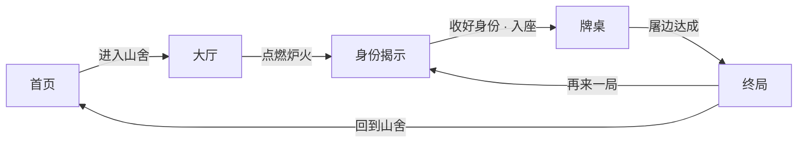

夜间顺序：

```text
守卫 → 狼人 → 女巫 → 预言家 → 结算 → 天亮
```

白天顺序：

```text
公布死讯 → 依次发言 → 投票 → 放逐/平票 → 遗言 → 下一夜
```

胜负条件：

- 好人：所有狼人出局
- 狼人：屠边，即所有村民出局或所有神职出局

---

## 2. 总体架构

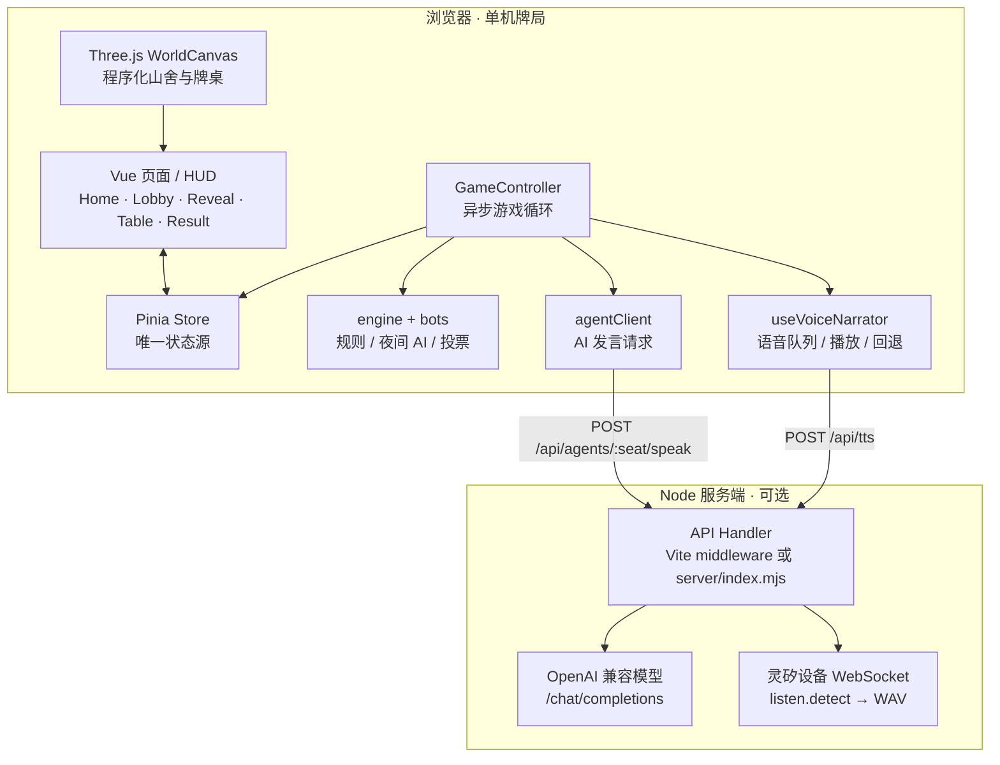

### 2.1 职责边界

- **浏览器是牌局权威**：洗牌、夜间结算、投票、胜负判定都在 `src/game/engine.ts` 和 `GameController` 内完成，不依赖服务端裁决。
- **服务端只做两件事**：代理 LLM 生成 AI 发言，代理灵矽 TTS。服务端不保存牌局，也不参与规则。
- **Pinia 是 UI 唯一事实源**：控制器写入 `players / phase / logs / prompt / winner` 等状态，Vue 和 Three.js 只读这些状态。
- **3D 与 DOM 分离**：3D 只负责场景、人偶和氛围；座位芯片、日志、行动面板都是 DOM，保证中文清晰、可点击、可访问。
- **Key 不下发浏览器**：`AGENT_LLM_API_KEY`、`XROBO_API_KEY`、设备 MAC 只在 Node 进程。

### 2.2 运行形态

开发时 Vite 直接挂载同一个 API Handler，只需要一个 `npm run dev`：

```text
Vite dev server :5188
  ├─ /            Vue SPA
  └─ /api/*       server/handler.mjs
```

生产时 Node 同时提供静态文件和 API：

```text
Nginx :443 /mulin/  →  Node 127.0.0.1:8787
                         ├─ /api/*   handler.mjs
                         └─ /*       dist 静态文件 + SPA fallback
```

---

## 3. 目录与模块

```text
mulin-night/
├─ index.html
├─ vite.config.ts                 # Vite + /api middleware + 分包
├─ DESIGN.md                      # 详细设计文档
├─ README.md
├─ server/
│  ├─ index.mjs                   # 生产静态服务器 + API
│  ├─ handler.mjs                 # /api/health、/api/agents、/api/tts
│  ├─ agents.mjs                  # 9 位角色人设 / 规则提示词
│  ├─ tts.mjs                     # 灵矽设备 WS、PCM→WAV、缓存、串行队列
│  ├─ voice-profiles.mjs          # 9 个灵矽音色 ID / 语速 / 音高
│  ├─ provision-agents.mjs        # 创建/更新 9 个 XRobot 智能体
│  └─ agent-registry.json         # 生成物，含 agent ID，已 gitignore
├─ src/
│  ├─ main.ts                     # 挂载、全局音频解锁
│  ├─ App.vue                     # 3D 背景、路由、场景幕布
│  ├─ router/index.ts             # 5 个路由 + 牌局守卫
│  ├─ views/                      # Home/Lobby/Reveal/Table/Result
│  ├─ components/
│  │  ├─ scene/WorldCanvas.vue
│  │  ├─ table/                   # SeatChip/ActionDock/GameLog/RoleCard...
│  │  └─ ui/                      # BrandMark/RoleIcon/TravelerPortrait...
│  ├─ game/
│  │  ├─ types.ts                 # Phase/Player/LogEntry/Prompt/HumanAction
│  │  ├─ engine.ts                # 洗牌、夜间结算、投票、胜负
│  │  ├─ bots.ts                  # 本地夜间/发言/投票策略
│  │  ├─ controller.ts            # 异步主循环、发言、Prompt 桥接
│  │  ├─ agentClient.ts           # 健康检查 + AI 发言请求
│  │  ├─ voice.ts                 # 预合成、缓存、隐藏日志、等待器
│  │  └─ random.ts                # 可复现随机数
│  ├─ composables/
│  │  ├─ useVoiceNarrator.ts      # 语音队列、WebAudio/HTMLAudio、浏览器回退
│  │  └─ useAmbientAudio.ts       # 程序化环境声
│  ├─ stores/game.ts              # Pinia 状态、ask/answer
│  ├─ three/                      # 场景、相机、投影、程序化材质
│  ├─ data/                       # 9 位角色、5 种身份
│  ├─ assets/roles/               # 6 张 SVG 角色卡
│  └─ styles/                     # token + base
├─ deploy/                        # Nginx / systemd / 登录页 / 部署说明
├─ docs/                          # 智能体文档、截图
└─ dist/                          # 构建产物
```

### 3.1 前端分层

| 层 | 文件 | 职责 |
| --- | --- | --- |
| 路由 / 壳 | `src/router`、`App.vue` | 五页切换、场景家族幕布、牌局访问守卫 |
| 视图 | `src/views/*` | 页面级 UI 与生命周期 |
| HUD 组件 | `src/components/table/*` | 座位、行动面板、夜话记录、身份卡、阶段横幅 |
| 状态 | `src/stores/game.ts` | 玩家、阶段、日志、Prompt、投票、统计 |
| 规则 | `src/game/engine.ts` | 发牌、夜间结算、同守同救、屠边、平票 |
| AI | `src/game/bots.ts` | 夜间目标、发言、怀疑度、投票、遗言 |
| 编排 | `src/game/controller.ts` | 夜/昼主循环、人类 Prompt、AI 发言、语音同步 |
| 语音 | `src/game/voice.ts`、`useVoiceNarrator.ts` | 预合成、隐藏/揭示、播放、回退 |
| 3D | `src/three/*` | 木屋、石桌、松林、月亮、灯光、座位投影 |

### 3.2 状态机

```ts
type Phase = 'idle' | 'reveal' | 'night' | 'dawn' | 'discussion' | 'vote' | 'result';
```

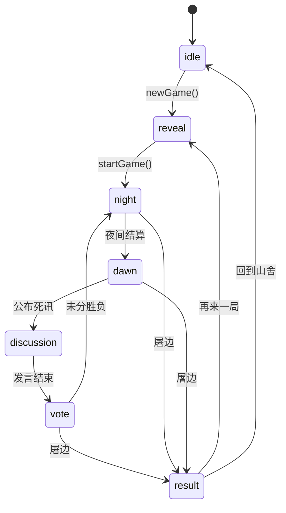

人类交互通过 Promise 桥接，UI 不直接推进规则：

```text
controller.ask(prompt)
  → store.prompt = prompt
  → ActionDock 收集 HumanAction
  → store.answer(action)
  → Promise resolve
  → controller 继续
```

---

## 4. 游戏内容

### 4.1 身份

| 身份 | 数量 | 阵营 | 能力 |
| --- | ---: | --- | --- |
| 狼人 | 3 | 狼人 | 每晚共同袭击一人；白天隐藏身份、误导好人 |
| 村民 | 3 | 好人 | 无夜间技能，靠发言和投票 |
| 预言家 | 1 | 好人 | 每晚查验一人阵营，结果仅自己可见 |
| 女巫 | 1 | 好人 | 解药/毒药各一瓶，每晚最多用一种 |
| 守卫 | 1 | 好人 | 每晚守护一人，不能连续两晚守同一人；同守同救仍死亡 |

猎人只在规则弹窗的角色图鉴中作为「未加入本局」的设定卡出现。

### 4.2 九位旅人

| 座位 | 名字 | 职业 | 语气 |
| ---: | --- | --- | --- |
| 01 | 沈砚 | 制图师 | 克制、确认方向、尊重事实 |
| 02 | 白棠 | 药师 | 温和、留余地、草药比喻 |
| 03 | 陆离 | 猎户 | 短、直、有压迫感 |
| 04 | 苏九 | 说书人 | 从容、戏谑、故事试探 |
| 05 | 顾青 | 守林人 | 沉稳、朴素、重视责任 |
| 06 | 江眠 | 旅店老板 | 热络、周到、护短 |
| 07 | 温辞 | 抄经人 | 敏感、谨慎、偶尔结巴 |
| 08 | 阿箬 | 采菇人 | 轻、怯、直觉准 |
| 09 | 裴照 | 提灯人 | 冷静、克制、有条理 |

人物与座位固定；身份牌每局随机洗牌。人类固定 1 号位，角色固定为沈砚。

### 4.3 场景

- **木屋家族**：首页 / 大厅。暮色松林、石径、提灯旅人、原木墙体、烟囱、暖窗、门灯、火塘、月亮、萤火、薄雾。
- **牌桌家族**：身份 / 牌桌 / 终局。石座圆桌、九把椅子、符文转盘、蜡烛、卡牌、8 个人偶；夜间闭眼，天亮睁眼，出局者下沉。
- 所有场景和角色卡插画均由代码生成，不依赖外部模型、贴图或图片服务。

### 4.4 渲染性能预算

3D 场景是持续渲染的，因此对 GPU/CPU 做了明确的预算，而不是把显示器刷新率和 Retina 分辨率直接拉满：

- 设备像素比封顶：桌面 `1.3×`，移动端 `1.15×`；不再使用 1.9× Retina 全量渲染。
- 后处理链按 CSS 分辨率渲染，`OutputPass` 再上采样；Bloom 只在夜间/黄昏开启，白天直接渲染。
- 桌面/移动端统一上限 30 fps；无交互 7 秒后降到 20 fps；浏览器标签页隐藏或窗口失焦时完全暂停循环。
- 阴影贴图不再每帧重绘，改为约 4 次/秒；移动端关闭阴影。
- WebGL 使用 `powerPreference: 'default'`，避免在双显卡 Mac 上强制拉起独显。
- 牌桌/木屋只更新当前可见场景的人偶与旅人动画；静态木屋、牌桌家具和旅人躯干按材质合批，显著降低 draw call。

这些设置是“氛围优先、持续挂机不烫”的折中；如果未来需要更高画质，可以在设置中增加“高画质”开关，而不是默认全开。

---

## 5. 智能体与语音

项目里有三个容易混淆的概念：

| 概念 | 当前用途 |
| --- | --- |
| OpenAI 兼容 LLM | 生成 8 位 AI 旅人的公开发言 |
| 灵矽智能体（agent ID） | 在灵矽控制台创建/管理角色配置、绑定设备；**不直接用于牌桌文字对话** |
| 灵矽 TTS 设备 WebSocket | 把每句文字合成为对应座位音色的 WAV |

### 5.1 文字发言链路

```text
GameController.discussion()
  → 构造每个 AI 座位的私有上下文
  → 并行请求 /api/agents/:seat/speak
  → server/handler.mjs 校验 seat、压缩上下文、拼角色 system prompt
  → OpenAI 兼容 /chat/completions
  → normalizeSpeech（去 Markdown、去说话人前缀、限 120 字）
  → 返回一段中文发言
  → 失败/超时回退 src/game/bots.ts 的本地模板
```

- 8 个 AI 座位（2–9）各自有独立人设、私有信息和发言约束。
- 夜间刀人、守护、用药、查验、投票由本地规则 AI 决定，LLM 不参与裁决。
- 预言家起跳/报查杀由规则引擎决定，避免模型编造查验结果。
- 没有 `AGENT_LLM_API_KEY` 时，`botSpeech` 保证牌局仍可完整进行。
- `AGENT_LLM_MOCK=1` 用固定文案联调前后端，不调用远程模型。

### 5.2 灵矽智能体 ID 的边界

灵矽公开 API 提供：

- `GET /xiaozhi/agent/list`、`GET /xiaozhi/agent/{id}`、`GET /xiaozhi/agent/search`
- `POST /xiaozhi/agent`、`PUT /xiaozhi/agent/{id}`、`DELETE /xiaozhi/agent/{id}`
- `PUT /v1/devices/{mac}/agent/{id}` 设备绑定切换
- 设备 WebSocket 握手支持 `X-Agent-ID`

但公开文档没有「agent ID + 文本 → 文本」的直接 HTTP 对话接口。所以本项目采用双层接入：

- **牌桌文字**：OpenAI 兼容模型 + `server/agents.mjs` 中同一套人设。
- **角色配置**：`npm run agents:provision` 用灵矽智能体 API 创建/更新 9 个智能体，并写入 `ttsVoiceId`。
- **TTS**：服务端通过已绑定设备的 WebSocket 合成，逐句用 `agent_params.voice` 切换音色。

生成出的 `server/agent-registry.json` 含 agent ID，已加入 `.gitignore`，不要提交。

### 5.3 TTS 链路

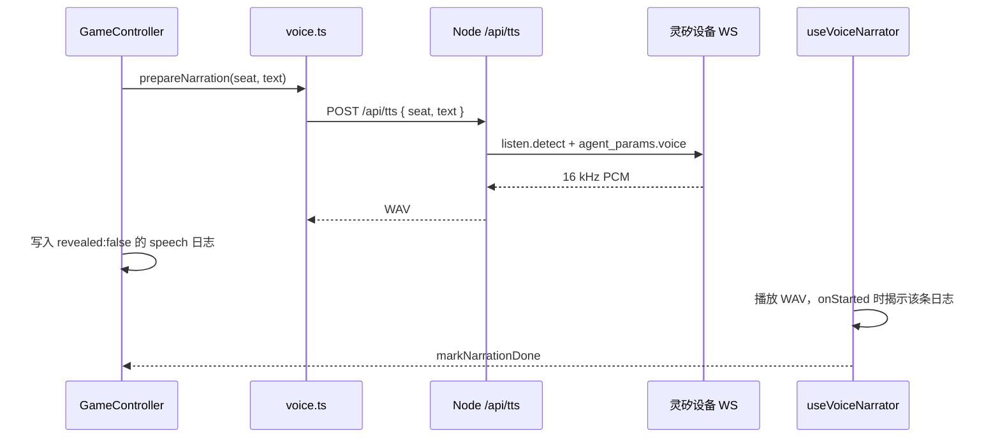

- 9 个座位在 `server/voice-profiles.mjs` 中使用不同音色 ID、语速、音高。
- 服务端用一台已绑定账号的 TTS 设备串行合成，避免设备会话抢占；结果按 `seat + voiceId + text` 缓存。
- 服务端单次 TTS 超时 22 秒；前端预合成 18 秒，播放请求 20 秒，正常请求通常 4–8 秒。
- 远端 TTS 失败、设备未绑定或超时，前端回退到浏览器 `speechSynthesis`，仍按角色设置不同音高和语速。
- 顶部扬声器按钮可关闭/开启角色语音；悬停会显示当前是「灵矽AI」还是「浏览器回退」。

### 5.4 文字/语音同步策略

**桌面端（严格同步）**

1. 当前句先调用 `prepareNarration` 合成。
2. 合成完成后写入 `revealed:false` 的隐藏日志。
3. 音频真正开始播放时，`onStarted` 将该条日志揭示。
4. 播放结束（真实 `ended`）后才进入下一位。
5. 当前语音播放期间，预取下一句。

**移动端（文字优先）**

- 移动浏览器对异步音频、自动播放和预合成更严格，不能把文字绑在音频上。
- 文字立即显示，语音异步播放；控制器最多等待 20 秒，避免整局卡住。
- 首次触摸/点击/按键在 `main.ts` 中全局解锁 AudioContext，后续优先播放远端 WAV。
- 播放失败才回退浏览器语音；牌桌不会因为回退而停住。

---

## 6. 服务端 API

| 方法 | 路径 | 说明 |
| --- | --- | --- |
| `GET` | `/api/health` | 运行状态、模型、9 个 agent 配置数、TTS 状态 |
| `GET` | `/api/agents` | 9 位角色 profile（seat/name/title/tone） |
| `POST` | `/api/agents/:seat/speak` | 根据牌局上下文生成一句 AI 发言 |
| `POST` | `/api/tts` | `{ seat, text }` → `audio/wav` |

### 6.1 Health

```json
{
  "ok": true,
  "service": "mulin-agent-bridge",
  "configured": true,
  "provider": "openai-compatible",
  "model": "deepseek/deepseek-v4-flash-20260731",
  "agents": 9,
  "linxAgents": 9,
  "linxModel": "deepseek-v4-flash",
  "provisioning": true,
  "tts": { "provider": "xrobot", "configured": true }
}
```

### 6.2 AI 发言

```http
POST /api/agents/4/speak
Content-Type: application/json

{
  "context": {
    "seat": 4,
    "round": 2,
    "day": 2,
    "role": "werewolf",
    "faction": "wolf",
    "aliveSeats": [1, 2, 4, 6],
    "teammates": [2],
    "claims": [],
    "seerChecks": [],
    "witch": { "antidote": false, "poison": false },
    "guardLast": null,
    "players": [],
    "recentPublic": []
  }
}
```

服务端只接受白名单上下文，人设和 system prompt 由 `seat` 查表生成，客户端不能覆盖。

### 6.3 TTS

```http
POST /api/tts
Content-Type: application/json

{ "seat": 2, "text": "昨夜平安，先听听大家怎么说。" }
```

成功返回 `audio/wav`，响应头 `X-Voice-Provider: xrobot`。错误返回 JSON：

```json
{ "ok": false, "error": "tts_failed", "message": "..." }
```

限制：单条文本 260 字符、音频 4MB、服务端 22 秒超时、请求体 64KB。

---

## 7. 配置

复制 `.env.example` 为 `.env`。所有 Key 只在服务端读取，Vite 不会把非 `VITE_*` 变量打进浏览器。

### 7.1 模型

| 变量 | 默认 / 说明 |
| --- | --- |
| `AGENT_LLM_BASE_URL` | `https://api.qnaigc.com/v1`，任意 OpenAI 兼容端点 |
| `AGENT_LLM_API_KEY` | 七牛 MaaS 或兼容服务的 Key；留空则走本地策略 |
| `AGENT_LLM_MODEL` | `deepseek/deepseek-v4-flash-20260731` |
| `AGENT_LLM_MOCK` | `1` 时用固定角色文案，不调用远程模型 |
| `AGENT_TIMEOUT_MS` | 单次模型请求超时，默认 12000 |

### 7.2 灵矽 / TTS

| 变量 | 默认 / 说明 |
| --- | --- |
| `XROBO_API_KEY` | 灵矽 API Key；用于创建 agent 和 TTS 设备 WS |
| `XROBO_BASE_URL` | `https://xrobo.qiniu.com` |
| `XROBO_LLM_MODEL_ID` | `f3626c105383d71654a57f2bb8a973f3`（DeepSeek V4 Flash） |
| `XROBO_MEM_MODEL_ID` | `Memory_nomem` |
| `XROBO_INTENT_MODEL_ID` | `Intent_nointent` |
| `XROBO_AGENT_PREFIX` | `暮林夜话` |
| `XROBO_TTS_WS_URL` | `wss://xrobo-io.qiniuapi.com/v1/ws/` |
| `XROBO_TTS_DEVICE_MAC` | 已绑定账号的虚拟设备 MAC；默认示例值不可用于生产 |

### 7.3 部署

| 变量 | 说明 |
| --- | --- |
| `APP_BASE_PATH` | 构建时使用，例如 `/mulin/`；同时决定路由 base 和 API 前缀 |
| `PORT` | 生产 Node 端口，默认 `8787` |

---

## 8. 本地开发

要求 Node.js 22+。

```bash
npm install
npm run dev
# http://127.0.0.1:5188
```

常用命令：

```bash
npm run typecheck          # vue-tsc --noEmit
npm run build              # 类型检查 + Vite 生产构建
npm run preview            # 预览 dist（127.0.0.1:5189）
npm run serve              # 生产 Node 服务（dist + /api）
npm run agents:dry-run     # 只打印 9 个智能体请求体
npm run agents:provision   # 创建/更新 9 个 XRobot 智能体
```

### 8.1 无 Key 跑通

```bash
npm run dev
```

- 牌局完整可玩。
- AI 走 `botSpeech` 本地模板。
- 如果没有 `/api/tts`，语音回退浏览器 `speechSynthesis`。
- 静态 `dist` 直接打开也能玩规则，但没有服务端语音。

### 8.2 接入模型

```bash
cp .env.example .env
# 填写 AGENT_LLM_API_KEY
npm run dev
```

### 8.3 接入灵矽 TTS / 智能体

```bash
# .env 中填写 XROBO_API_KEY
npm run agents:dry-run
npm run agents:provision
```

`agents:provision` 会：

1. 拉取当前账号的智能体列表；
2. 按 `agentName` 匹配 `暮林夜话·沈砚` … `暮林夜话·裴照`；
3. 不存在则创建，存在则更新人设、`ttsVoiceId`、语速/音高；
4. 把 agent ID 写入 `server/agent-registry.json`。

---

## 9. 构建与部署

### 9.1 本地生产构建

```bash
npm run build
npm run serve
# http://127.0.0.1:8787
```

`server/index.mjs` 同时提供 `dist/` 静态文件和 `/api`，SPA 路由回退到 `index.html`。

### 9.2 子路径部署

生产环境挂在 `/mulin/` 下：

```bash
APP_BASE_PATH=/mulin/ npm run build
```

`APP_BASE_PATH` 同时作用于：

- Vite 资源 base
- Vue Router history base
- `src/game/apiBase.ts` 生成的 `/mulin/api/*`

Nginx 的 `/mulin/` location 会剥掉前缀再代理到 `127.0.0.1:8787`。

### 9.3 访问控制

生产预览使用**第一方 Cookie 门禁**，不是 Basic Auth：

- 第一次访问 `?access=<token>` 设置 `mulin_access` Cookie；
- 之后 `/mulin/` 直接访问；
- 缺失/错误 Cookie 重定向到 `/mulin/login.html`；
- Cookie 为 `HttpOnly; Secure; SameSite=Lax`，30 天有效。

这样可避免部分移动 Safari 对模块脚本/样式子资源重复弹 Basic Auth 导致的白屏。

完整 Nginx、systemd、登录页和服务器布局见 [deploy/README.md](deploy/README.md)。真实 Token 只存在服务器 Nginx 配置，不在仓库中。

---

## 10. 设计取舍与已知限制

### 已明确的设计取舍

- **单机而非联机**：先保证完整可玩和低部署成本；规则权威在浏览器。
- **3D 只做氛围**：DOM 承载文字与交互，避免 3D 中文模糊、不可访问。
- **规则与表达分离**：夜间行动/投票由可复现的规则 AI 决定，LLM 只负责公开发言，避免模型破坏规则。
- **TTS 走服务端**：Key、设备 MAC 和 WebSocket 凭据不进浏览器；浏览器只接收 WAV。
- **桌面严格同步，移动文字优先**：两种运行时对自动播放的限制不同，分别优化。

### 已知限制

- 单机、单设备，不持久化；刷新页面会重新开局。
- 牌桌文字仍由 OpenAI 兼容模型生成，没有逐句调用灵矽 agent ID；灵矽公开 API 没有直接文本对话接口。
- 9 个灵矽智能体是角色配置/设备绑定资产，不等于 9 条独立文本推理链路。
- TTS 使用一台绑定设备串行合成；首句或设备排队时可能比后续句子慢。
- 远端 TTS 不可用时回退浏览器语音；不同系统的浏览器基础音色可能相同，只能靠音高/语速区分。
- 3D 为程序化风格化场景，不是写实模型；Three.js chunk 较大。
- 目前没有自动化测试套件，主要依赖 `vue-tsc`、构建和桌面/移动端手工/CDP 验收。

---

## 11. 截图

### 角色图鉴

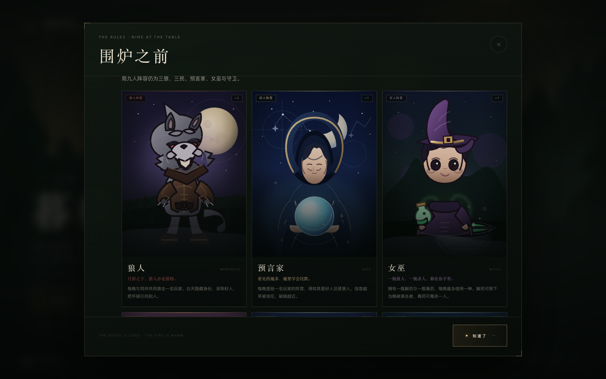

### 首页与牌桌

| 首页 | 牌桌 · 夜 |
| --- | --- |
| 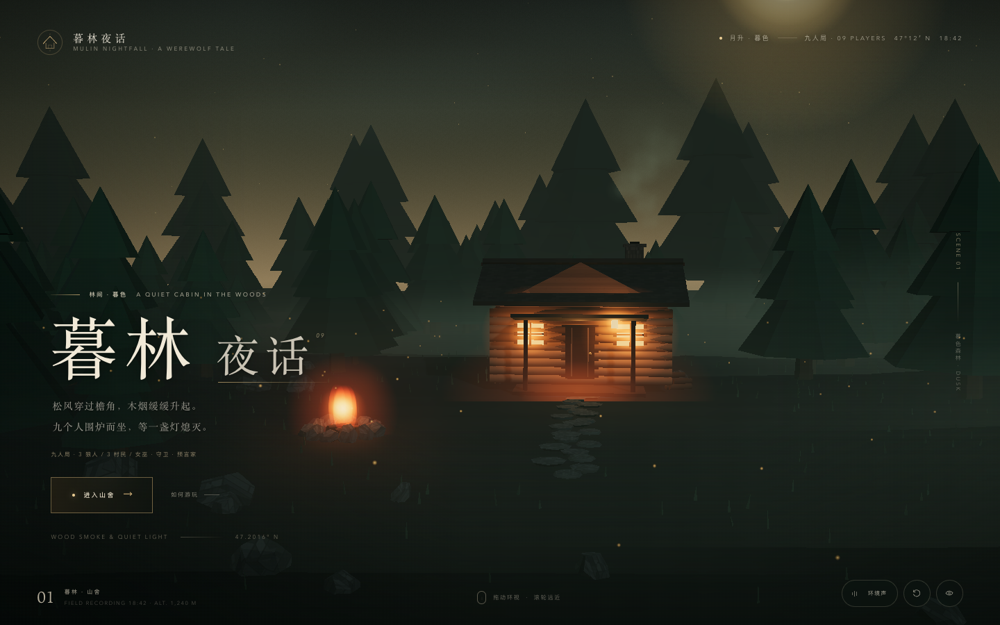 | 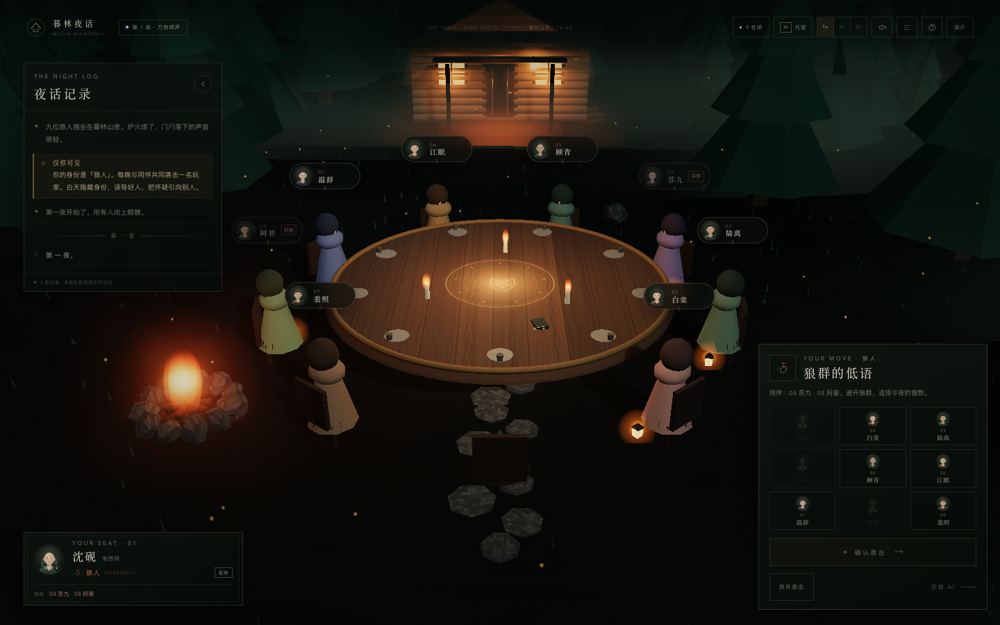 |

| 牌桌 · 天亮 | 守卫行动 |
| --- | --- |
| 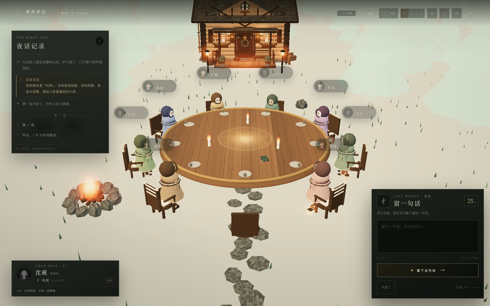 | 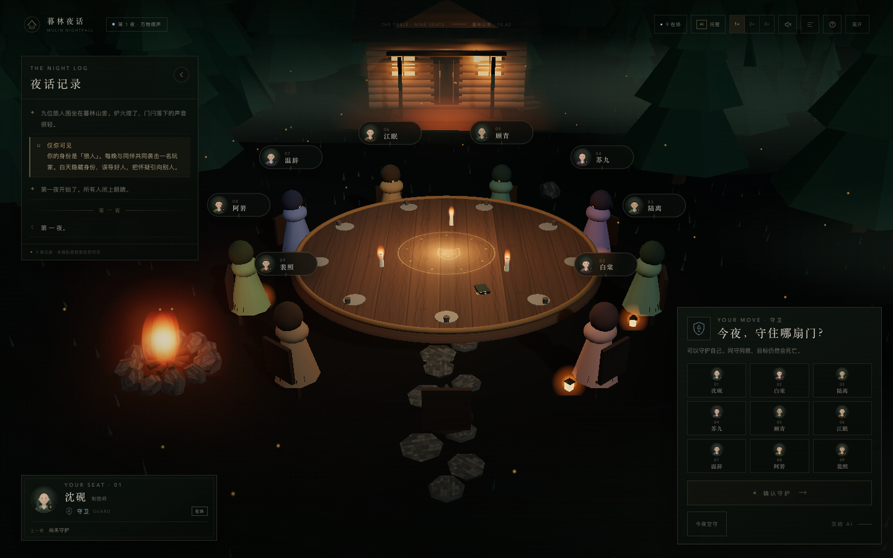 |

| 终局 |
| --- |
| 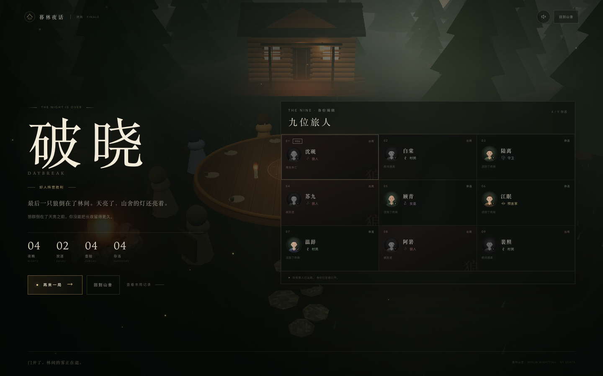 |

| 移动端牌桌 | 移动端终局 |
| --- | --- |
| 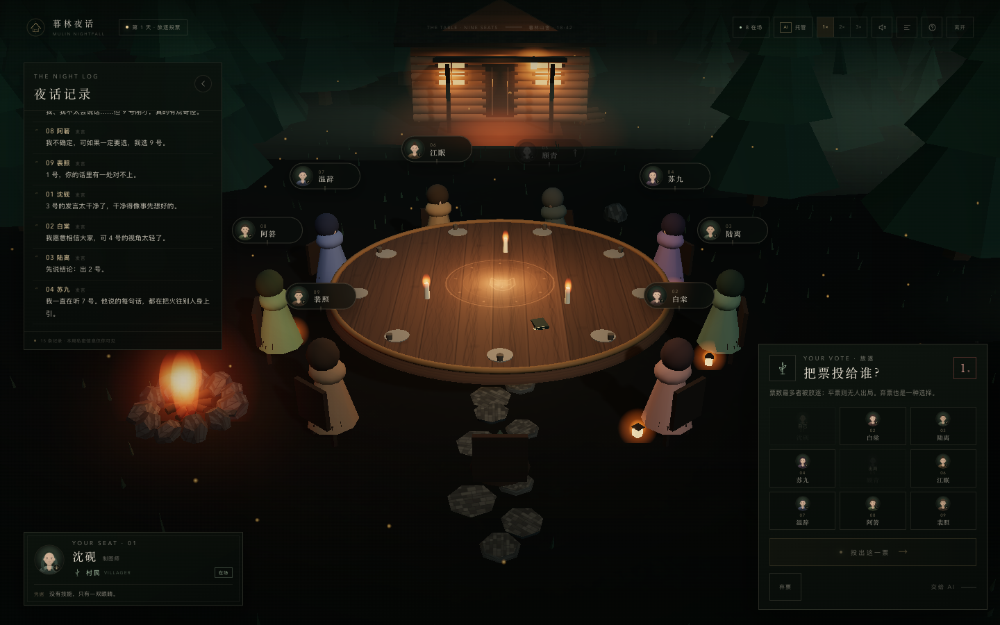 | 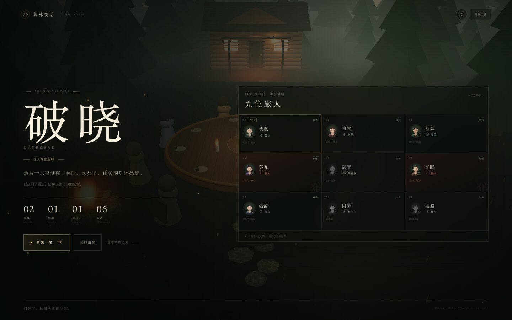 |

---

## 12. 更多文档

- [DESIGN.md](DESIGN.md)：流程、状态机、3D 场景、组件树、规则边界、设计取舍
- [docs/AGENT_INTEGRATION.md](docs/AGENT_INTEGRATION.md)：模型/灵矽配置、9 个智能体、TTS 细节、安全边界
- [deploy/README.md](deploy/README.md)：生产部署、Cookie 门禁、systemd、健康检查
