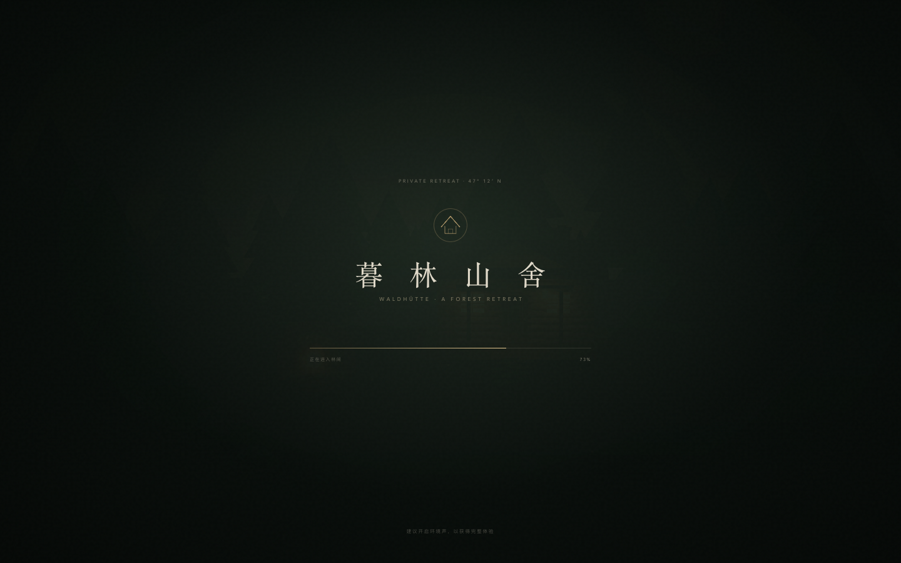

# 暮林夜话 · MULIN NIGHTFALL

九人局狼人杀 · Vue 3 + TypeScript + Three.js 单机 3D 原型。可选接入 8 位 LLM 智能体。

- 3 狼人 / 3 村民 / 1 女巫 / 1 守卫 / 1 预言家
- 玩家固定 1 号位，8 位 AI 旅人
- 无联机；无 Key 时不需要后端，程序化 3D 暮林山舍，完整夜间、发言、投票、遗言、终局
- 可选 Node 智能体代理：8 位 AI 旅人各自接入 OpenAI 兼容模型 / 灵矽角色人设

## 运行

```bash
npm install
npm run dev
# http://127.0.0.1:5188
```

```bash
npm run typecheck
npm run build
npm run preview

# 智能体（可选）
cp .env.example .env
# 填入 AGENT_LLM_API_KEY
npm run dev

# 创建 / 更新 8 个 Xrobot 智能体（可选，需要 XROBO_API_KEY）
npm run agents:dry-run
npm run agents:provision
```

不配置 Key 也能玩；大厅会显示「本地策略」。配置 `XROBO_API_KEY` 后显示「灵矽智能体 · 8 位已建」；再配置 `AGENT_LLM_API_KEY` 才显示「智能体在线 · 8 位」，8 位旅人的发言由模型生成。

## 设计文档

完整流程、状态机、组件树、3D 场景、规则与取舍见 [DESIGN.md](DESIGN.md)。

智能体接入、Key 配置、8 个 Xrobot 智能体创建方式见 [docs/AGENT_INTEGRATION.md](docs/AGENT_INTEGRATION.md)。

## 截图



| 首页 | 牌桌 |
| --- | --- |
|  |  |

| 守卫行动 | 终局 |
| --- | --- |
|  |  |

| 移动端牌桌 | 移动端终局 |
| --- | --- |
|  |  |

## 目录

```
src/
├─ game/       规则引擎、AI、异步控制器
├─ stores/     Pinia 单一状态源
├─ three/      程序化场景、相机、投影
├─ components/ 启动幕布、3D 画布、牌桌 HUD、UI 基础件
└─ views/      首页 / 大厅 / 身份 / 牌桌 / 终局
```

## 说明

参考页 `forest-cabin.html` 中的 Three.js 代码不完整；当前 3D 场景按参考页的美术方向重新程序化搭建，并保留了启动 loader 的文案、版式与节奏。
